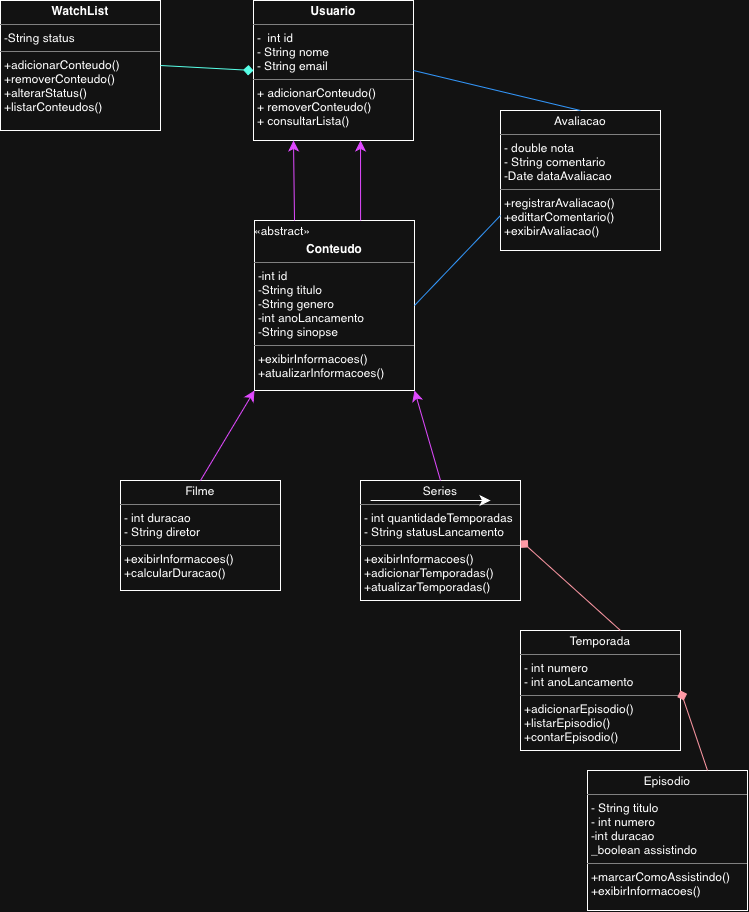

# sistemaCineTrack 🎬

### Sistema de organização de filmes e séries em Java

## Equipe
- Bianca Luiza da Silva
- Isabella Ramos do Amaral
- Lays Vitória Alvez Sampaio

## Proposta do sistema
O CineTrack será um sistema desenvolvido em Java para organizar filmes e séries que os usuários desejam assistir, estão assistindo ou já finalizaram. A plataforma permitirá cadastrar títulos, registrar avaliações, acompanhar o progresso das séries e organizar uma lista pessoal de conteúdos.

A ideia é funcionar como uma espécie de catálogo pessoal de entretenimento, reunindo informações que normalmente ficam espalhadas entre aplicativos de streaming, anotações e listas.

## Funcionalidades do sistema
- **Cadastro de filmes e séries:** registrar título, gênero, ano de lançamento, classificação indicativa e sinopse.
- **Minha Watchlist:** adicionar conteúdos que deseja assistir futuramente.
- **Avaliações pessoais:** dar notas aos filmes e séries assistidos e registrar comentários.
- **Acompanhamento de séries:** registrar temporadas e episódios assistidos.
- **Pesquisa e filtros:** buscar conteúdos por título, gênero, ano ou situação de visualização.

## Diagrama UML
O diagrama abaixo representa as principais classes do CineTrack e seus relacionamentos.



## Conceitos de Programação Orientada a Objetos
| Conceito | Aplicação no CineTrack |
|---|---|
| **Classes e objetos** | Representar filmes, séries, usuários e avaliações. |
| **Atributos** | Armazenar título, gênero, ano, duração e status. |
| **Métodos** | Cadastrar, pesquisar, avaliar e atualizar conteúdos. |
| **Encapsulamento** | Proteger os dados e controlar alterações por meio dos métodos de acesso. |
| **Herança** | Reutilizar características de `Conteudo` em `Filme` e `Serie`. |
| **Polimorfismo** | Exibir informações de filmes e séries de formas diferentes. |
| **Abstração** | Modelar somente os dados e comportamentos necessários ao sistema. |

## Principais classes
- **Conteudo:** classe abstrata que reúne informações comuns a filmes e séries, como título, gênero e ano de lançamento.
- **Filme:** representa os filmes cadastrados, armazenando informações como duração e diretor.
- **Serie:** representa as séries, organizando informações sobre temporadas e status de lançamento.
- **Temporada:** representa uma temporada de uma série e reúne seus episódios.
- **Episodio:** armazena informações de cada episódio, como título, duração e status de visualização.
- **Usuario:** representa quem utiliza o sistema para organizar e avaliar seus conteúdos.
- **Avaliacao:** registra a nota e o comentário do usuário sobre um filme ou série.
- **Watchlist:** organiza os conteúdos que o usuário deseja assistir, está assistindo ou já finalizou.

## Funcionalidades do projeto
O CineTrack será um sistema para cadastrar, organizar e acompanhar filmes e séries, permitindo que o usuário gerencie seus conteúdos favoritos e seu progresso de visualização.

### Principais funcionalidades
- **Cadastrar conteúdos:** adicionar filmes e séries com informações como título, gênero, ano de lançamento e sinopse.
- **Consultar conteúdos:** visualizar os filmes e séries cadastrados no sistema.
- **Pesquisar e filtrar:** localizar conteúdos pelo título, gênero ou tipo.
- **Gerenciar watchlist:** adicionar ou remover conteúdos da lista pessoal.
- **Atualizar status:** marcar conteúdos como “Quero assistir”, “Assistindo” ou “Finalizado”.
- **Acompanhar séries:** organizar temporadas e episódios, registrando o progresso de visualização.
- **Avaliar conteúdos:** atribuir notas e escrever comentários sobre filmes e séries.
- **Editar e excluir registros:** modificar informações ou remover conteúdos cadastrados.
- **Consultar avaliações:** visualizar as notas e os comentários registrados pelo usuário.
- **Exibir informações:** apresentar os detalhes de cada filme ou série de forma organizada.

## Organização e implementação
O projeto utiliza Java e conceitos de Programação Orientada a Objetos. Os dados são mantidos em memória com coleções `ArrayList`, sem persistência em banco de dados nesta versão.

### Arquivos principais
- `Conteudo.java`: classe base abstrata para conteúdos.
- `Filme.java` e `Serie.java`: classes específicas para filmes e séries.
- `Usuario.java`: representa os usuários.
- `Avaliacao.java`: armazena notas e comentários.
- `Lista.java`: gerencia listas de conteúdos.
- `CineTrack.java`: contém o menu e a interação com o usuário.

## Como executar
É necessário ter o **JDK (Java Development Kit)** instalado.

1. Abra um terminal na pasta do projeto.
2. Compile os arquivos:
   ```bash
   javac *.java
   ```
3. Execute o programa:
   ```bash
   java CineTrack
   ```

## Escopo atual
O diagrama enviado pela equipe apresenta também as classes `Temporada`, `Episodio` e `WatchList`. Elas fazem parte do modelo planejado para o sistema. A implementação atual pode não conter ainda todos os detalhes dessas classes, que podem ser desenvolvidos nas próximas etapas.
